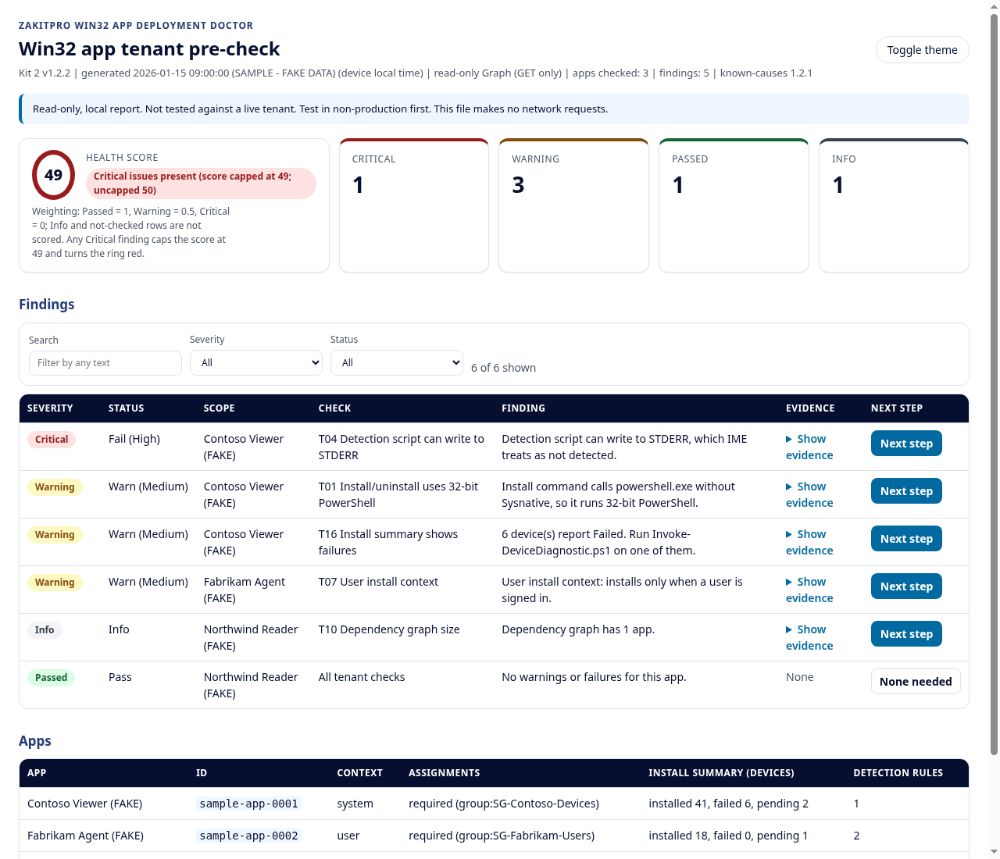
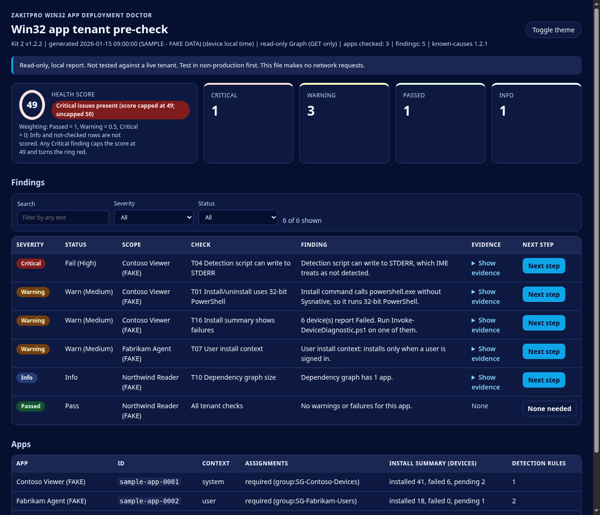

# Deployment Doctor (beta scripts)

Read-only PowerShell diagnostics for Windows Autopilot / Autopilot device preparation (Kit 1 scripts v1.3.2) and Intune Win32 app deployments (Kit 2 scripts v1.2.2), from ZakitPro.

> **Warning: not tested against a live tenant.** These scripts have been checked only with PSScriptAnalyzer and Pester unit tests that use mocked Graph responses and synthetic log files. They have not been run on a real tenant or a real device.
>
> **Test in non-production first.** Run them in a test tenant and on a test device before you use them anywhere else. They are provided AS IS under the MIT license, with no warranty.

Join the Deployment Doctor waitlist: https://zakitpro.com/doctor/

## How this differs from Pre-Check Lite
The free [Pre-Check Lite](https://zakitpro.com/doctor/) is one script that runs 3 read-only Device Prep tenant checks (service principal, device group, local admin) and prints PASS/FAIL/WARN/SKIP lines. This beta is the full script set from both kits: 2 tenant pre-checks and 2 on-device diagnostics, with HTML/JSON reports.

## Quick start
**PowerShell:** Windows PowerShell 5.1 or PowerShell 7.x (every script has `#Requires -Version 5.1`). The device diagnostics run on the Windows device itself. Kit 1's device script is written for Windows PowerShell 5.1, so it also works at Shift+F10 during OOBE.

**Graph module (tenant scripts only):**
```powershell
Install-Module Microsoft.Graph.Authentication -Scope CurrentUser -MinimumVersion 2.0
```
Sign in with an account that can read Intune and Entra (for example Global Reader plus an Intune read-only role). If execution policy blocks a script, review it, then `Unblock-File` that file. Don't set the policy to Bypass globally.

**Run:**
```powershell
# Kit 1 tenant pre-check (Autopilot / Device Prep). Report folder default: current folder
.\kit1\scripts\Invoke-TenantPreCheck.ps1 -TenantId contoso.onmicrosoft.com -OutputPath C:\Temp\DD

# Kit 1 device diagnostic. Run elevated (or as SYSTEM at Shift+F10); without admin it warns and some logs/keys are unreadable.
# Report folder default: $env:TEMP. -ExpectedMode Any|AutopilotV1|DevicePrep
.\kit1\scripts\Invoke-DeviceDiagnostic.ps1 -ExpectedMode DevicePrep -OutputPath D:\
# Try it first on FAKE data, on any machine with PowerShell 7 (reads only the sample folder, nothing on this computer):
.\kit1\scripts\Invoke-DeviceDiagnostic.ps1 -SamplePath .\kit1\sample-data\device-prep-failure -OutputPath C:\Temp\DD

# Kit 2 tenant pre-check (Win32 apps). Report folder default: .\ZakitPro-Kit2-Reports
.\kit2\scripts\Invoke-TenantPreCheck.ps1 -TenantId contoso.onmicrosoft.com -AppNameFilter "Contoso" -OutputPath C:\Temp\DD

# Kit 2 device diagnostic. Local admin recommended (the IME log folder ACL). Report folder default: %TEMP%\ZakitPro-Kit2
.\kit2\scripts\Invoke-DeviceDiagnostic.ps1 -OutputPath C:\Temp\DD
# Offline, on logs copied from another device, cross-referenced with the Kit 2 tenant report:
.\kit2\scripts\Invoke-DeviceDiagnostic.ps1 -LogPath D:\Collected\Logs -SkipRegistry -TenantReportPath C:\Temp\DD\Kit2-TenantPreCheck-<stamp>.json
```
Each tenant script also takes `-SkipConnect`, which reuses an existing `Connect-MgGraph` session. All four take `-PassThru`.

**Reports:** each run writes a timestamped JSON report and an HTML report to `-OutputPath`: `TenantPreCheck-*`, `DeviceDiagnostic-*`, `Kit2-TenantPreCheck-*` or `Kit2-DeviceDiagnostic-*`. Add `-NoHtml` to write only the JSON.

**Report results:** open a [Test report](https://github.com/zakopenc/deployment-doctor-beta/issues/new?template=test-report.md). Before you post, remove tenant names, tenant/device/user IDs, UPNs and any secrets, and don't attach unredacted reports.

## What is in this repo
```
kit1/scripts/Invoke-TenantPreCheck.ps1     Kit 1 tenant pre-check (Graph, read-only)
kit1/scripts/Invoke-DeviceDiagnostic.ps1   Kit 1 on-device diagnostic (no Graph, no network)
kit1/data/known-causes.json                Signal map the Kit 1 scripts need to run (see below)
kit1/tests/Kit1.Tests.ps1                  Pester tests
kit1/sample-data/                          FAKE datasets for the Kit 1 device script's -SamplePath mode
kit2/scripts/Invoke-TenantPreCheck.ps1     Kit 2 Win32 app tenant audit (Graph, read-only)
kit2/scripts/Invoke-DeviceDiagnostic.ps1   Kit 2 on-device IME log diagnostic (no Graph, no network)
kit2/scripts/known-causes.json             Signal map the Kit 2 scripts need to run (see below)
kit2/scripts/tests/                        Pester tests and synthetic log fixtures
kit1/tests/Report.Tests.ps1, kit2/scripts/tests/Report.Tests.ps1   HTML report tests
docs/                                      Sample report (fake data) and its generator
```
46 known causes (30 script-detected, 2 reminder, 14 manual) are referenced by the Kit 1 signal map.

The `known-causes.json` files are trimmed signal maps: cause IDs, match signals/patterns, status and source links. The scripts load them to label findings, so they are required. The explanations and fixes from the full kits are not included; the reports show "Removed from the beta scripts repo" in their place.

## Local HTML report
Each script writes one self-contained HTML dashboard next to its JSON report. It uses inline CSS and inline vanilla JavaScript only, with no external files, CDNs, web fonts or telemetry. A Content-Security-Policy meta tag blocks network requests from the page.
- **Summary header:** a health score, plus status cards with counts (Critical, Warning, Passed, Info). A legend under the score (also shown as a tooltip and in the footer) explains the weighting: Passed = 1, Warning = 0.5, Critical = 0, and Info and not-checked rows are not scored. Score = `round(100 x (Passed + 0.5 x Warning) / (Passed + Warning + Critical))`. If any Critical finding exists, the score is capped at 49, the ring turns red and a "Critical issues present" label appears.
- **Findings table:** severity pills (each with a text label), the real status (for example `Fail (High)`), a Confidence column when a finding has one (Kit 2 verdicts; heuristic name-matching checks are labelled), scope, check and the finding's actual detail. Evidence is HTML-escaped and collapsible (`<details>`). A **Next step** button links to Microsoft Learn; when no Learn page exists, the cell shows the KC/check code instead.
- **Filters:** filter by severity and by status, and search by text. With JavaScript disabled, the filters stay hidden and the full table is shown.
- **Themes:** light and dark, following `prefers-color-scheme`, plus a toggle button. Colours come from the ZakitPro design system, with accessible contrast. Text uses the system font stack.
- **Print:** print CSS expands all evidence, shows every row, and prints link URLs.
- **Header:** each kit's own name. A Kit 2 device report built with `-LogPath` names the analysed log source ("Offline log analysis") instead of the computer it ran on. A Kit 1 `-SamplePath` report says "Sample data" and "FAKE".
- **Not applicable checks:** on a tenant with no Autopilot device preparation policy, Kit 1's Device Prep service principal and custom-role checks report Info ("Not applicable now") instead of Critical/Warning. With a Standard-user Device Prep policy, the Entra local-admin check reports Warn, not Pass, when that setting can't be read.
- **Resilient tenant scan (Kit 2):** each app is checked on its own. If one app object can't be evaluated, it gets a Warning finding (`T00`) and the rest of the apps are still checked and reported.
- **`-NoHtml`:** writes only the JSON report. The scripts stay read-only: the local report files are the only thing they write.

| Light | Dark |
|---|---|
|  |  |

*Samples generated by `docs/New-SampleReport.ps1` from invented data (Contoso/Fabrikam/Northwind, placeholder IDs).*

## What each script checks

### Kit 1: `Invoke-TenantPreCheck.ps1` (tenant, read-only Graph)
- Intune Provisioning Client service principal exists (AppID `f1346770-5b25-470b-88bd-d5744ab7952c`).
- Each Device Prep policy's device group: exists, assigned (not dynamic), not role-assignable, owned by that service principal, plus Intune's own validation result.
- Custom Intune roles that appear to carry the enrollment-time device membership permission (heuristic), and whether the device group is in a role assignment's scope.
- Entra "registering user is added as local administrator" vs. Device Prep "Standard user" policies.
- Windows enrollment restrictions blocking personal devices vs. corporate identifiers present.
- ESP profiles whose blocking apps mix LOB MSI and Win32 apps, or include Microsoft 365 Apps (C2R).
- Device Prep app (25) and script (10) caps; selected apps not assigned to the device group.
- Device-context PowerShell scripts that will run during ESP (30-minute timeout).

Sends only GET requests, plus the documented read action `POST .../retrieveEnrollmentTimeDeviceMembershipTarget`.

### Kit 1: `Invoke-DeviceDiagnostic.ps1` (device, no Graph)
Reads ESP tracking and Autopilot/provisioning registry keys, Device Prep (Bootstrapper), ModernDeployment Autopilot (807/809/815/908) and CodeIntegrity 3033 events, IME install state/version and logs (AppWorkload EspPhase lines, "actively refused"), and PowerShell script timeout signals. Builds a phase-ordered timeline and prints the MDMDiagnosticsTool command to run before any reset (it does not run it). Writes only an HTML and a JSON report.

### Kit 2: `Invoke-TenantPreCheck.ps1` (tenant, read-only Graph)
For each Win32 app: definition, assignments, dependencies/supersedence and install summary. Checks: 32-bit PowerShell in install/uninstall; environment variables in uninstall; ServiceUI in commands; detection scripts that can write to STDERR or have no STDOUT write; product-code detection pinned to a version; detection rules hard-coding a 32-bit location or using the 64-bit view; user install context; large package with default timeout (heuristic); 1618 not mapped to Retry; hard-reboot return codes; dependency graph size; supersedence chain length; superseding app not assigned; dependency on a superseded app; supersedence auto-update; allowedArchitectures vs. applicableArchitectures; install-summary failures; untargeted auto-install dependencies; and (optional) the Intune Windows Agent enterprise app being disabled. A guard refuses any HTTP method other than GET.

### Kit 2: `Invoke-DeviceDiagnostic.ps1` (device, no Graph)
Parses IME logs (IntuneManagementExtension, AppWorkload, AppActionProcessor, including rolled-over files) with a clean-room CMTrace parser, reads the `Win32Apps` registry state and the IME service version, builds a per-app timeline and matches signals to the signal map. Can analyse a copied log folder offline (`-LogPath ... -SkipRegistry`) and cross-reference the Kit 2 tenant report.

## Microsoft Graph scopes (delegated, read-only)
Taken from the scripts. No ReadWrite scope is requested.

| Script | Scopes |
|---|---|
| Kit 1 tenant pre-check | `Application.Read.All`, `GroupMember.Read.All`, `Policy.Read.DeviceConfiguration`, `DeviceManagementServiceConfig.Read.All`, `DeviceManagementConfiguration.Read.All`, `DeviceManagementApps.Read.All`, `DeviceManagementRBAC.Read.All` |
| Kit 2 tenant pre-check | `DeviceManagementApps.Read.All`, `Group.Read.All`; plus `Application.Read.All` only with `-IncludeAgentAppCheck` |
| Device diagnostics (both kits) | None (no Graph, no network) |

Both tenant scripts need `Microsoft.Graph.Authentication` 2.x. Several endpoints are Graph `/beta` and can change.

## Running the tests
```powershell
Install-Module Pester -MinimumVersion 5.0 -Scope CurrentUser
Install-Module PSScriptAnalyzer -Scope CurrentUser
Invoke-Pester -Path ./kit1/tests, ./kit2/scripts/tests
```
One test is skipped on purpose in this repo: it checks that every KC ID cited by the paid Kit 1 guide exists, and the guide isn't published here.

## Reporting results
Open an issue with the **Test report** template. Remove tenant names, tenant/device/user IDs, UPNs and any secrets before you post.

## License
MIT, see [LICENSE](LICENSE). Third-party credits: [CREDITS.md](CREDITS.md). Checksums: [SHA256SUMS.txt](SHA256SUMS.txt).
